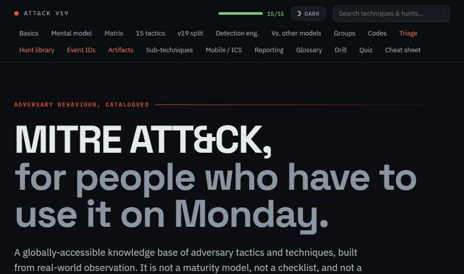
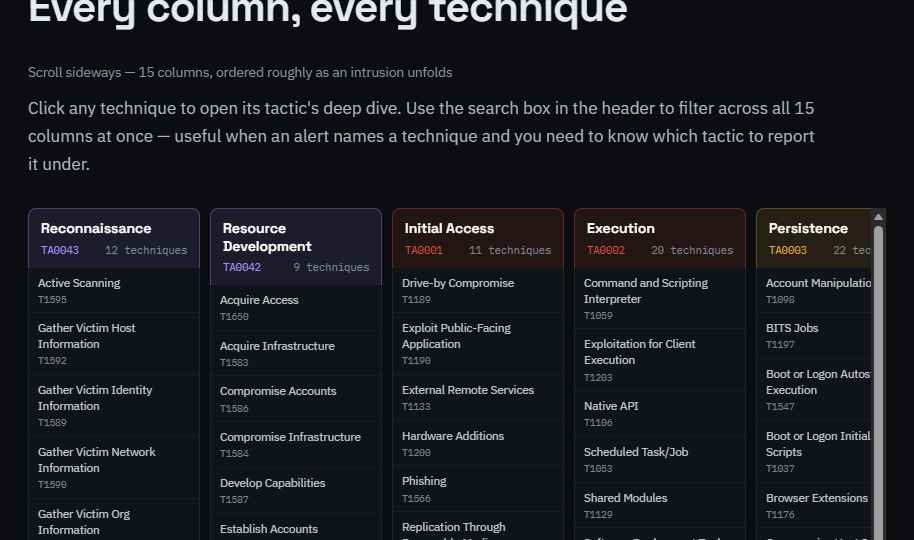
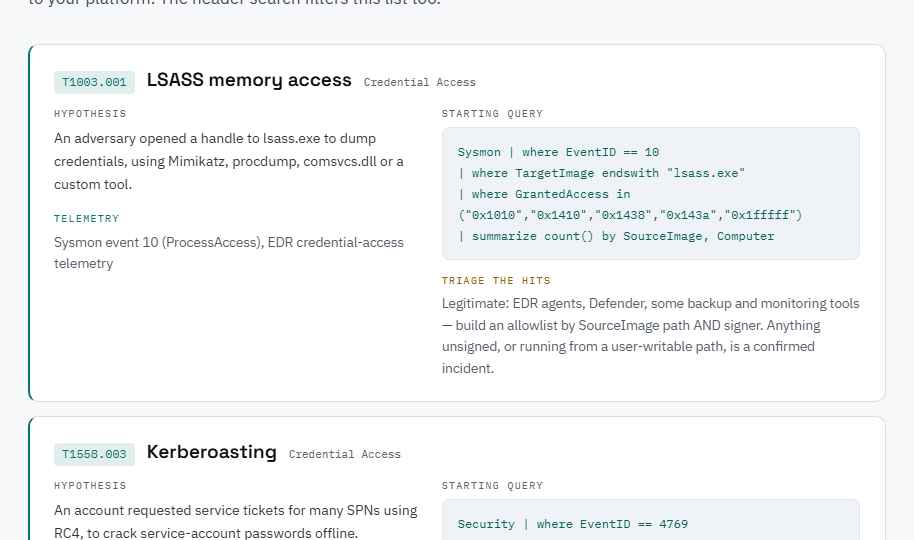
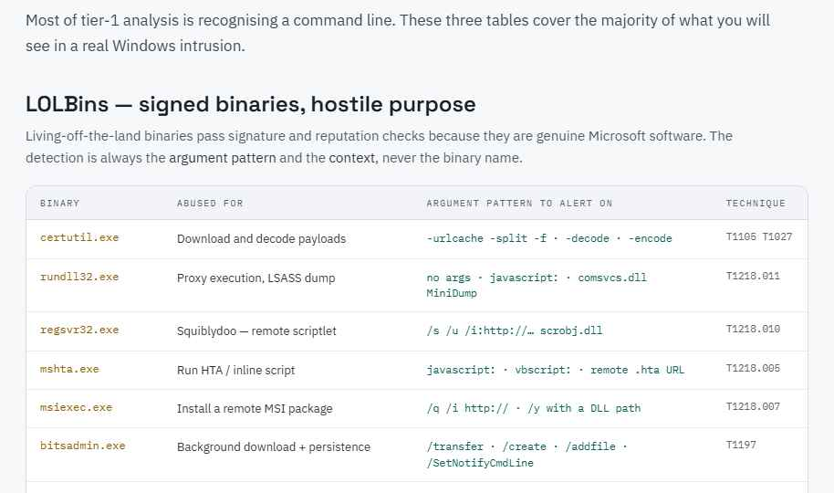

<div align="center">

# MITRE ATT&CK — Analyst Study Guide

**A single HTML file that teaches you ATT&CK and then helps you actually use it on shift.**

Built on Enterprise **v19** — including the Defense Evasion split into *Stealth* and *Defense Impairment*.

[](https://attack.mitre.org/)
[](#-quick-start)
[](#-quick-start)
[](#-quick-start)
[](#-whats-inside)
[](#-license)

<a href="#-quick-start"><b>Quick start</b></a> ·
<a href="#-whats-inside"><b>What's inside</b></a> ·
<a href="#-who-its-for"><b>Who it's for</b></a> ·
<a href="#-publish-it-as-a-website"><b>Publish it</b></a> ·
<a href="#-faq"><b>FAQ</b></a>



</div>

---

## Why this exists

Most ATT&CK material makes you pick one of two things:

- **Reference material** that is exhaustive but impossible to memorise, or
- **Study material** that is memorable but useless when a real alert lands in the queue.

This guide is both, in one file. The left half teaches the framework — hierarchy, mnemonics, per-tactic deep dives, flashcards, a scored quiz. The right half is the part you keep open during a shift — a triage playbook, 20 ready-to-run hunts, event ID tables, and a LOLBin argument-pattern decoder.

No install. No account. No network. Double-click `index.html` and it works — on an air-gapped analyst workstation, on a plane, in an exam prep session at 2am.

---

## 🚀 Quick start

**Option 1 — just use it**

```bash
git clone https://github.com/mahialjaber/mitre-attack-study-guide.git
cd mitre-attack-study-guide
open index.html      # macOS
start index.html     # Windows
xdg-open index.html  # Linux
```

**Option 2 — no git**

Download [`index.html`](index.html) and open it. That single file is the entire application: fonts, styles, logic and all 20 sections are inlined. Nothing else is required, and nothing is fetched at runtime.

> [!TIP]
> Drop it in your notes vault, a USB stick, or a SOC jump box. It renders identically everywhere and leaves no trace beyond a `localStorage` key for your own progress.

---

## 📚 What's inside

Twenty sections, ordered from *learn it* → *use it* → *test it*.

### Foundations

| § | Section | What you get |
|:--|:--------|:-------------|
| 01 | **Basics** | Tactic → technique → sub-technique → procedure hierarchy, the full ID scheme (TA/T/S/G/C/M/DS/DET/AN), matrices and platform coverage |
| 02 | **Mental model** | The 5-act narrative of an intrusion, plus a 15-word mnemonic that gets the tactic order into your head in one sitting |
| 03 | **Matrix** | All 15 columns with every technique and ID, filterable from the header |
| 04 | **Deep dive** | Per tactic: the adversary's goal in one line, a memory hook, the techniques that matter in real incidents, the telemetry that actually catches them, mitigations, and the trap that catches people out |
| 05 | **v19 split** | Why Defense Evasion was retired, what moved to Stealth (TA0005) vs Defense Impairment (TA0112), and the SIEM blind spot it created |

### Practice

| § | Section | What you get |
|:--|:--------|:-------------|
| 06 | **Detection engineering** | Anatomy of an ATT&CK-mapped detection, Navigator layer strategy, the threat-informed defense loop, and six mapping mistakes that get flagged in review |
| 07 | **Vs. other models** | Kill Chain, Unified Kill Chain, D3FEND, ATLAS, CAPEC/CWE/CVE, NIST CSF — plus the Pyramid of Pain and a hard list of what ATT&CK is *not* |
| 08 | **Groups** | 9 tracked adversary groups with their signature techniques, 10 software entries, and two full intrusions narrated tactic by tactic |
| 09 | **Codes** | All 42 mitigations (M-codes) and the key data sources (DS-codes), plus highest-value telemetry ranked |

### On shift

| § | Section | What you get |
|:--|:--------|:-------------|
| 10 | **Triage** | A first-fifteen-minutes playbook, five questions that resolve most alerts, and an **urgency-by-tactic table** — the single most useful thing ATT&CK gives a tier-1 analyst |
| 11 | **Hunt library** | **20 hunts.** Each with a hypothesis, the telemetry it needs, a starting query, and how to tell a true positive from an admin doing their job |
| 12 | **Event IDs** | Windows Security/System and Sysmon reference tables mapped to techniques, must-knows starred, logon-type decoder, plus Linux, cloud and identity sources |
| 13 | **Artifacts** | **28 LOLBins** with the exact argument patterns to alert on, 12 process-tree red flags, suspicious-path tells, and PowerShell obfuscation flags |
| 14 | **Sub-techniques** | Full sub-technique lists for the 10 techniques that actually come up |
| 15 | **Mobile / ICS** | Tactics unique to each matrix, plus ATLAS for adversarial ML |
| 16 | **Reporting** | A per-observation template and six rules that make an incident report reusable |
| 17 | **Glossary** | 28 terms that reports and interviews use without ever defining |

### Recall

| § | Section | What you get |
|:--|:--------|:-------------|
| 18 | **Flashcard drill** | Shuffleable deck, click to flip, prompt → goal + hook + signature technique |
| 19 | **Quiz** | 14 questions with an explanation for every answer, self-scoring |
| 20 | **Cheat sheet** | The whole framework as one table, plus interview answers worth having ready |

<div align="center">

<em>§03 — the full Enterprise matrix, searchable, every column clickable through to its deep dive</em>
</div>

---

## ✨ Features

- 🌗 **Dark / light mode** — toggle in the header, remembered between visits
- 🔍 **Unified search** — one box filters techniques across all 15 columns *and* the hunt library
- ✅ **Progress tracking** — mark tactics learned; a progress bar follows you down the page
- 🃏 **Flashcards + scored quiz** — active recall, not passive reading
- 🔗 **Deep-linkable** — every section has a stable anchor (`#hunt`, `#artifacts`, `#cheat`…) so you can bookmark the bit you use most
- 📴 **Zero network calls** — nothing loads at runtime, nothing phones home
- 🖨️ **Print-friendly** — the cheat sheet and glossary print cleanly

<div align="center">

<em>§11 — every hunt gives you the hypothesis, the telemetry, a starting query, and how to triage the hits</em>
</div>

---

## 👥 Who it's for

| You are… | Start here |
|:---------|:-----------|
| **Studying for an interview or exam** | §02 mnemonic → §04 deep dives → §18 flashcards → §19 quiz → §20 cheat sheet |
| **New to a SOC** | §10 triage playbook → §12 event IDs → §13 artifact decoder |
| **A detection engineer** | §06 detection engineering → §11 hunt library → §09 data sources |
| **Doing threat hunting** | §11 hunt library → §08 groups → §13 process-tree red flags |
| **Writing up an incident** | §16 reporting template → §14 sub-techniques for precision |
| **Briefing non-security people** | §02 mental model → §07 vs. other frameworks |

---

## 🌐 Publish it as a website

The repository is structured to be published directly via GitHub Pages:

1. In your repository on GitHub, navigate to **Settings → Pages**.
2. Under **Build and deployment**, select **Deploy from a branch**.
3. Choose branch `main` and folder `/ (root)`, then click **Save**.

Your guide will be live at `https://mahialjaber.github.io/mitre-attack-study-guide/` in about a minute.

---

## 📁 Repository layout

```text
mitre-attack-study-guide/
├── index.html                   # Interactive standalone single-file study guide
├── LICENSE                      # MIT License
├── README.md                    # Documentation & user guide
├── docs/                        # Screenshots & visual assets
│   ├── hero-dark.png
│   ├── hunt-light.png
│   ├── lolbins-light.png
│   └── matrix-dark.png
└── src/                         # Source files
    ├── study-guide-source.dc.html
    └── support.js
```

<div align="center">

<em>§13 — 28 LOLBins, and the argument patterns that separate abuse from normal use</em>
</div>

---

## ❓ FAQ

<details>
<summary><b>Which ATT&CK version is this?</b></summary>
<br>

Enterprise **v19**. The most significant change it carries is the retirement of Defense Evasion (TA0005), split by adversary intent into **Stealth** (which inherited TA0005) and **Defense Impairment** (the new TA0112). §05 covers the split in full, including why any SIEM rule that only references TA0005 now has a gap.

</details>

<details>
<summary><b>Is my progress saved? Where?</b></summary>
<br>

Yes — learned tactics and your theme choice are stored in your browser's `localStorage` under a single key (`attack-study-v1`). It never leaves your machine. Clearing site data resets it.

</details>

<details>
<summary><b>Can I run the hunt queries as-is?</b></summary>
<br>

No — treat them as starting points. They are written in KQL-style pseudocode to stay readable; you will need to adapt field and table names to Sentinel, Splunk, Elastic, Chronicle or whatever you run. The value is in the *hypothesis* and the *triage guidance*, which port anywhere.

</details>

<details>
<summary><b>Why one giant HTML file instead of a proper site?</b></summary>
<br>

Because the environments where this is most useful — locked-down analyst workstations, air-gapped labs, exam prep with no wifi — are exactly the ones where "just run npm install" is not an option. One file that always works beats a nicer architecture that sometimes doesn't.

</details>

<details>
<summary><b>How do I edit it?</b></summary>
<br>

Edit the source file, not the build. `index.html` is a compiled single-file bundle; changes to it will be overwritten. Content lives in the source file's data arrays — tactics, hunts, LOLBins and glossary are all plain JavaScript objects, so adding a hunt is a matter of copying one entry and editing the strings.

</details>

<details>
<summary><b>Found something wrong?</b></summary>
<br>

Please open an issue — accuracy matters more than completeness here. Technique IDs shift between releases, and a handful of newly-promoted v19 techniques are deliberately marked `new` rather than carrying a guessed ID.

</details>

---

## ⚠️ Accuracy notice

> [!IMPORTANT]
> ATT&CK changes roughly twice a year (April and October). Technique counts, IDs and tactic membership in this guide reflect **v19** at time of writing. **Always verify against [attack.mitre.org](https://attack.mitre.org/) before citing an ID in a report, ticket or exam answer.**

---

## 🤝 Contributing

Issues and PRs welcome, especially:

- Corrections to technique IDs, counts or tactic mappings
- New hunts (keep the format: hypothesis → telemetry → query → triage)
- Additional LOLBins with real argument patterns
- Non-Windows coverage — Linux, macOS and cloud are thinner than they should be

---

## 📄 License

Released under the **MIT License** — use it, fork it, teach from it.

**ATT&CK®** is a registered trademark of The MITRE Corporation. Framework content is © MITRE and used under the [ATT&CK Terms of Use](https://attack.mitre.org/resources/legal-and-branding/terms-of-use/). This is an independent study aid and is **not affiliated with, endorsed by, or sponsored by MITRE**.

---

<div align="center">

**If this helped you learn ATT&CK or catch something on shift, a ⭐ is appreciated.**

</div>
